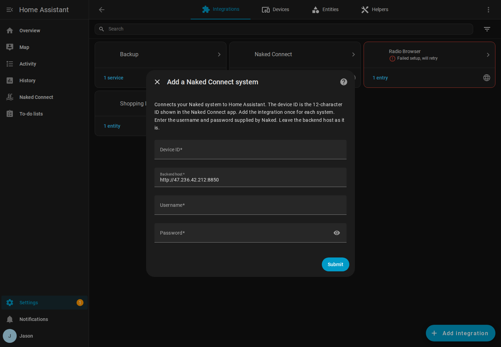
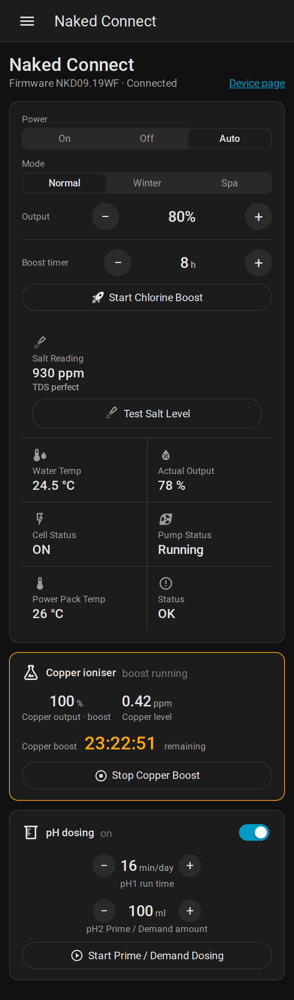
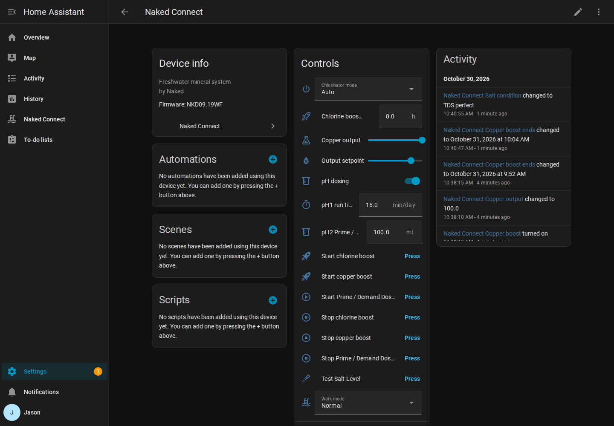

# Naked Connect for Home Assistant: Installation and Setup

This guide takes a fresh Home Assistant installation to a working Naked Connect setup. It takes about 10 minutes.

## What you need

- Home Assistant 2024.7 or newer
- A Naked system that is online and working in the Naked Connect app
- The **device ID** of your system: a 12-character code shown in the Naked Connect app
- The **username and password** supplied by Naked

## Step 1: Copy the integration into Home Assistant

Choose one method.

**Option A: HACS (recommended)**

If HACS isn't installed yet, follow the official guide at https://hacs.xyz/docs/use/ first.

1. In Home Assistant, open **HACS** from the sidebar.
2. Click the three-dot menu (top right) and choose **Custom repositories**.
3. In **Repository**, paste: `https://github.com/JaseznBrandio/naked-connect-ha`
4. In **Type**, choose **Integration**, then click **Add**.
5. Close the dialog, search HACS for **Naked Connect**, open it and click **Download**.

**Option B: Manual copy**

1. Install the **File editor** or **Samba share** add-on (Settings → Add-ons → Add-on store), or use SSH.
2. Open the `config` folder. Create a folder called `custom_components` if it doesn't exist.
3. Copy the `naked_connect` folder from this package into it, so you have `config/custom_components/naked_connect/manifest.json`.

## Step 2: Restart Home Assistant

Go to **Settings → System → Restart** (top right) → **Restart Home Assistant**. A custom integration is only detected after a restart.

## Step 3: Add the integration

1. Go to **Settings → Devices & services**.
2. Click **Add integration** (bottom right) and search for **Naked Connect**.
3. Enter the **device ID**, plus the **username** and **password** supplied by Naked.
4. Leave **Backend host** as it is, and click **Submit**.



If you see "Login was rejected", check the username and password. If you see "Could not reach the Naked Connect cloud", check that Home Assistant has internet access and that the system shows as online in the Naked Connect app.

## Step 4: What you'll see

### Naked Connect in the sidebar

A **Naked Connect** item appears in the left sidebar. It shows:

- **Controls:** power (On / Off / Auto), mode (Normal / Winter / Spa), output, and a chlorine boost timer with countdown.
- **Readings:** the salt reading and its condition with a **Test Salt Level** button, water temperature, actual output, cell, pump, power pack and status.
- **Copper ioniser:** copper output, copper level, and copper boost with a countdown.
- **pH dosing:** on/off, run time, and prime / demand dosing.

It follows the Home Assistant light or dark theme and works on phones.


On a phone:



To hide the sidebar item, go to **Settings → Devices & services → Naked Connect → Configure** and untick **Show Naked Connect in the sidebar**.

### Device page

**Settings → Devices & services → Naked Connect → Naked Connect** shows the standard Home Assistant device page with controls, sensors and settings. Click **Add to dashboard** to put these on any dashboard.



### A note on the salt test

The test takes about a minute. The result appears a few seconds after the unit finishes, together with the unit's verdict (for example "TDS perfect").

### More than one Naked system

Add the integration once per system (**Add integration → Naked Connect** again, with the other device ID). All systems appear on the same sidebar page.

## Troubleshooting

| Problem | Fix |
|---|---|
| HACS says "Repository structure is not compliant" | Make sure you pasted the repository URL exactly, and chose type **Integration**. |
| Naked Connect doesn't appear in **Add integration** | Check the folder path is `config/custom_components/naked_connect/` and restart Home Assistant. |
| Values show "Unavailable" | The system or the cloud is offline. Check the Naked Connect app. |
| Changes take a few seconds | Commands go through the cloud to the system. Updates normally arrive live within a second; if the live connection is down, Home Assistant polls instead. The unit purges for about 15 seconds before the cell turns on. |
| Copper output can't be changed | A copper boost is running. Stop it first, or wait for it to finish. |
| Polling interval | Default is every 30 seconds, and faster for a short while after a command or during a fault. Change it under **Naked Connect → Configure**. |

For detailed logs, add this to `configuration.yaml` and restart:

```yaml
logger:
  logs:
    custom_components.naked_connect: debug
```

## Updating

Click **Update** in HACS (or replace the `config/custom_components/naked_connect` folder with the new version), then restart Home Assistant. Your settings and entity names are kept.

## Removing

**Settings → Devices & services → Naked Connect → three-dot menu → Delete**, then delete the `config/custom_components/naked_connect` folder and restart.
