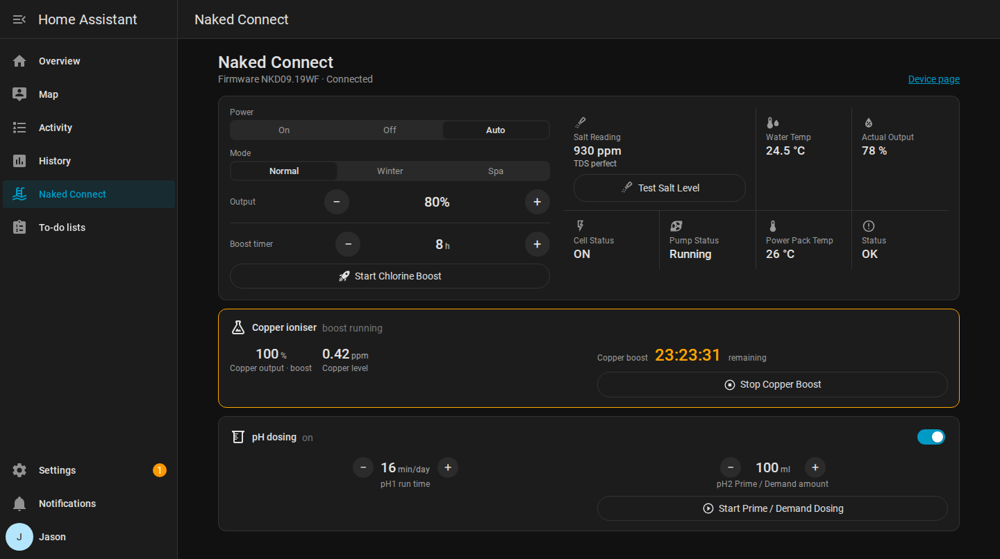

# Naked Connect for Home Assistant

A custom integration that brings your Naked freshwater mineral system into Home Assistant: water temperature, output, cell and pump status, salt (TDS) readings with a salt test button, the copper ioniser, pH dosing and full system control.

Naked has no official Home Assistant integration. This talks to the same cloud backend the Naked Connect app uses, logging in with the cloud credentials supplied by Naked and reading the system's latest reported values. It also subscribes to the cloud's live channel (the same one the app uses), so changes made in the app or on the unit appear within a second. If the live channel drops, it falls back to polling until it reconnects.

> **Installing this for the first time?** See [INSTALL.md](INSTALL.md) for a step-by-step guide with screenshots.

## Naked Connect sidebar page

After setup, a **Naked Connect** item appears in the Home Assistant sidebar: a ready-made control page with power, mode, output, chlorine boost, the salt reading with a **Test Salt Level** button, status readings, the copper ioniser and pH dosing. It follows your light or dark theme and works on mobile. No dashboard editing required.



Turn it off under **Naked Connect → Configure → Show Naked Connect in the sidebar** if you'd rather build your own dashboard.

## Entities

### System control

- **Chlorinator mode** (On / Off / Auto) and an **Output setpoint** slider (0 to 100%) for the active mode
- **Mode** (Normal / Winter / Spa), with the output control adjusting the setting for the active mode
- **Start chlorine boost** / **Stop chlorine boost** buttons, a **Chlorine boost duration** setting (hours, locked while boost runs) and a **Chlorine boost ends** countdown
- **Special mode** (Normal, Boost, Backwash, Salt test), **Running on** (which timer is active), and **Timer 1 / Timer 2** windows
- **Power pack temperature** (°C)
- **Status**: "OK", or every active fault in plain words, for example "Low flow" or "Low salt, Water temp low". The raw number is in the **Fault code** sensor.

Backwash is a multi-step routine on the unit and is left to the Naked Connect app.

### Salt test

- **Test Salt Level** button: runs the unit's salt test, the same as the app.
- **Salt reading** (ppm): the result of the last test.
- **Salt condition**: the unit's verdict, for example "TDS perfect" or "TDS high but OK".

The unit streams readings for about a minute during a test, and briefly reads low while the cell changes direction. Home Assistant takes the typical reading from the test, so that dip doesn't affect the result. The result appears a few seconds after the test ends.

### Copper ioniser

- **Copper output** (0 to 100%). Locked during a copper boost, when the unit runs at full output.
- **Start copper boost** / **Stop copper boost** buttons. A copper boost runs at full output for 27 hours, then the unit returns to the normal copper output.
- **Copper boost ends**: countdown while a copper boost runs.
- **Copper level** (ppm).
- **Copper ioniser** (working / idle) and **Copper boost** (on / off).
- Diagnostic: copper ioniser run time (hours), plus low-temperature hold and start-up flags (disabled by default).

### pH dosing

**pH dosing** on/off, with **pH1 run time** (min/day), **pH2 Prime / Demand amount** (ml) and **Start / Stop Prime / Demand Dosing** buttons. The amount is only sent when you press Start.

### Readings

Enabled by default: water temperature (°C), salt level (ppm), actual output (%), chlorine production (g), work mode, power mode, cell status, pump (running / not running), fault code.

Disabled by default (enable per entity if you want them): WiFi signal, pump, cell and power running hours, firmware version, pH dosing pump, cell direction.

Some readings (salt, pump, output, cell) only report while the unit is actively running, so they may read as unknown when it is idle. They fill in once the pump and cell come on.

## Requirements

- Home Assistant 2024.7 or newer
- The **device ID** of your Naked system: the 12-character code shown in the Naked Connect app
- The **username and password** supplied by Naked

## Install

### Option A: HACS (recommended)

1. In HACS, go to the three-dot menu → **Custom repositories**.
2. Add `https://github.com/JaseznBrandio/naked-connect-ha`, type **Integration**.
3. Download **Naked Connect**, then restart Home Assistant.

### Option B: Manual

1. Copy the `custom_components/naked_connect` folder into your Home Assistant `config/custom_components/` directory, so you end up with `config/custom_components/naked_connect/`.
2. Restart Home Assistant.

## Set up

1. **Settings → Devices & services → Add integration → Naked Connect**.
2. Enter your **device ID** and the **username** and **password** supplied by Naked. Leave the backend host as it is.
3. Submit. The integration logs in, confirms it can read the system, and creates the entities.
4. **More than one system?** Repeat these steps for each one. They all appear on the same Naked Connect sidebar page.

Change the polling interval (default 30 seconds) any time via the integration's **Configure** button.

## Example automation

Start a copper boost at 6am on the first day of each month:

```yaml
automation:
  - alias: Monthly copper boost
    triggers:
      - trigger: time
        at: "06:00:00"
    conditions:
      - condition: template
        value_template: "{{ now().day == 1 }}"
    actions:
      - action: button.press
        target:
          entity_id: button.naked_connect_start_copper_boost
```

(Entity IDs depend on your device name; check yours under Settings → Devices & services → Naked Connect.)

## Notes and caveats

- **Control goes through the cloud.** Commands are the same messages the Naked Connect app sends, so they need the system online and the cloud reachable.
- **Unofficial.** It relies on a private cloud API. An app or server update could change it and break this integration.
- The cloud currently uses plain HTTP, which is the platform's design, not a choice of this integration.

## Security

This integration connects to the cloud exactly as the official app does, and holds no access the app doesn't already have. Keep your device ID and login details private.

## License

MIT. Provided as-is.
